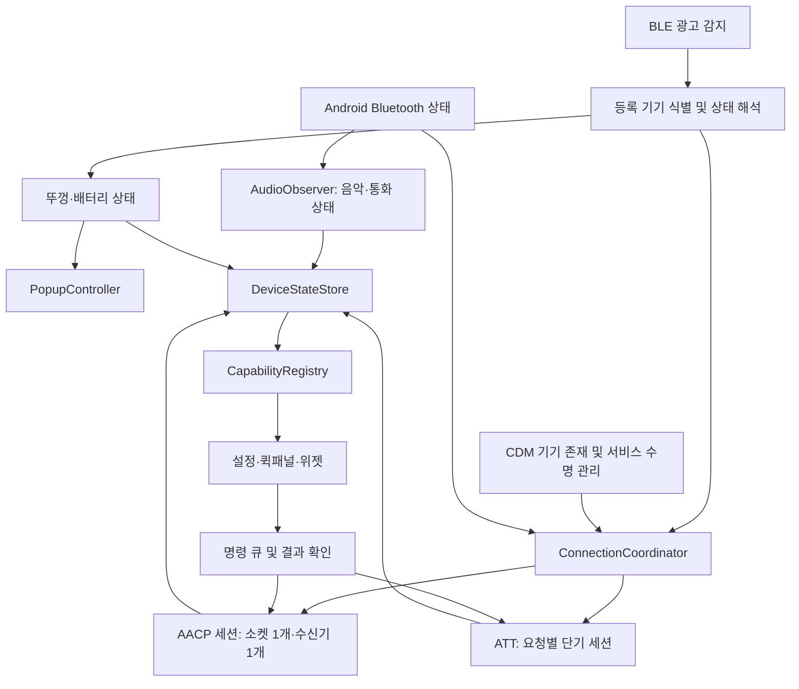

# 갤럭시용 AirPods 연결·음질·전체 기능 설계

작성일: 2026-10-02. 상태: 설계안. 앱 코드 변경, 실기기 성능 측정 및 기능 검증은 이번 작업에 포함하지 않았다.

## 1. 제품 목표와 기준

목표는 갤럭시 버즈처럼 케이스를 열면 빠르게 상태가 나타나고, 착용하면 음악을 사용할 수 있으며, 연결 복구와 설정 조작이 재생을 방해하지 않는 경험이다. AirPods가 제공하는 기능 중 접근 가능한 기능을 모두 목록화하고, 모델·펌웨어·권한별로 실제 동작을 검증한 기능부터 제공한다.

기본 대상은 **루팅하지 않은 갤럭시 + AirPods Pro 3**로 설계한다. 실제 보유 기기와 펌웨어는 착수 시 확인한다. Pro 2 및 다른 AirPods는 공통 연결 구조를 사용하고 모델별 기능을 확장한다. 과거 다른 체크아웃의 테스트 결과를 이 저장소의 검증 결과로 간주하지 않는다.

다음 세 가지는 별도 목표로 측정한다.

- 연결성: 팝업 반응, 오디오 사용 가능 시점, 제어 준비 시점, 끊김, 복구, 배터리 소비.
- 음질: 음악 재생, 통화 송수신, 마이크를 사용하는 게임·회의, 영상 지연을 각각 평가.
- 기능 범위: 기능 화면 존재가 아니라 설정 전송, 기기 반영, 읽기 확인, 재연결 후 동작까지 평가.

버즈의 SSC UHQ는 삼성의 전용 오디오 기술이다. AirPods와 갤럭시가 협상하지 않는 코덱을 일반 앱만으로 추가할 수 있다는 전제로 설계하지 않는다. 실제 드라이버, 착용 밀폐, Bluetooth 스택과 무선 환경도 앱의 통제 밖이다. 따라서 동일한 음색·무손실·통화 품질을 일괄 보장하지 않고, AirPods가 제공하는 최선의 경로를 유지한다. [삼성 공식 설명](https://www.samsung.com/us/audio-sound/galaxy-buds4-pro/)

Apple도 비 Apple 기기에서 기능 제한이 있음을 명시한다. Apple 계정·OS 통합에 의존하는 기능과 기기 내부 기능 제어를 구분한다. [AirPods Pro 공식 사양](https://www.apple.com/airpods-pro/specs/)

## 2. 핵심 구조

음악·통화 전송은 Android Bluetooth 스택이 담당한다. 앱은 그 상태를 관찰하고 허용된 연결 요청만 수행한다. AACP/ATT 오류를 이유로 정상 오디오 연결을 해제하거나 Bluetooth를 재시작하지 않는다.

| 구성 요소 | 책임 |
|---|---|
| PresenceSupervisor | 스캔·CDM 이벤트, Bluetooth 켜짐/꺼짐, 스캔 오류, 서비스 복구 |
| DeviceIdentityResolver | 페어링 기기와 광고 연결, 지원 시 IRK 기반 식별, 주변 타인의 기기 배제 |
| ConnectionCoordinator | 기기별 연결·복구 요청을 직렬화하고 중복 접속 방지 |
| AacpSession | 연결, 초기화, 알림 구독, 단일 수신 루프, 쓰기 직렬화, 정리 |
| AttClient | 요청별 연결·읽기·쓰기·닫기, 제한 시간, 결과 확인 |
| DeviceStateStore | 모든 화면이 공유하는 기기별 최신 상태와 출처·시각 |
| PopupController | 하나의 팝업을 표시·갱신·닫기, 중복 표시 방지 |
| AudioObserver | 음악·통화 프로필과 실제 라우트 관찰; 지원되는 범위에서 코덱 확인 |
| CapabilityRegistry | 모델·펌웨어·OS·권한·전송 경로·검증 결과로 사용 가능한 기능 결정 |

## 3. 연결 상태와 복구

### 3.1 상태를 분리한다

`DeviceState`에는 `presence`, `lid`, `left/right wear`, `battery`, `audio`, `control`, `capabilities`를 독립적으로 보관한다. UI는 `StateFlow`를 구독한다. `isConnected` 한 값으로 모든 기능을 활성화하지 않는다.

- 뚜껑: `Open / Closed / Unknown`. 마지막 수신 시각과 신뢰 근거 포함.
- 오디오: 음악 경로와 통화 경로를 각각 `Disconnected / Connecting / Ready`로 관찰.
- 제어: `Idle → Connecting → Initializing → Ready → Recovering`. 권한 부족은 `Blocked`.
- 특수 기능: `Unavailable / Available / Pending / Confirmed / Failed`, 마지막 확인값 포함.

소켓 연결만으로 제어 준비를 선언하지 않는다. 초기 핸드셰이크와 필요한 구독 응답 또는 해당 펌웨어에서 확인된 초기 상태 수신을 완료한 뒤 `Ready`로 전환한다. 오디오만 연결된 상태도 정상 상태로 표현한다.

### 3.2 소켓 소유권

ConnectionCoordinator 하나만 연결을 시작·교체·종료한다. BLE 이벤트, UI 버튼, 저장된 MAC 복구, 착용 이벤트는 모두 명령으로 전달한다. 기기별 접속 시도는 한 번에 하나만 허용한다.

- 세션마다 증가하는 `sessionId` 부여. 지난 세션의 수신·타이머·쓰기 결과는 폐기.
- 블로킹 I/O는 별도 실행 경로로 분리. 상태 처리 루프와 메인 스레드를 막지 않는다.
- 연결 제한 시간이 지나면 독립 watchdog이 해당 소켓을 실제로 닫는다. 코루틴 취소만으로 `connect()` 종료를 가정하지 않는다.
- EOF, 읽기 오류, 초기화 실패는 현재 세션만 정리하고 구독·작업·타이머를 취소.
- AACP는 정상 사용 중 단일 소켓과 단일 수신 루프 유지. 근거 없는 heartbeat나 반복 재접속을 추가하지 않는다.
- ATT는 단기 요청을 기본으로 유지한다. 지속 세션이 더 안정적이라는 실기기 근거가 생기기 전에는 변경하지 않는다.

기존 코드의 숨겨진 L2CAP 소켓 생성은 `TransportProvider` 뒤로 격리한다. 순정 환경에서 생성·연결·명령 응답 가능 여부를 먼저 검사한다. CDM 승인이 Apple 전용 프로토콜 접근이나 vendor ID 변경 권한까지 부여하지는 않는다. 비 SDK 접근은 Android 버전별 제한 영향을 받으므로 실패 시 음악과 BLE 상태만 유지한다. [Android 비 SDK 인터페이스 제한](https://developer.android.com/guide/app-compatibility/restrictions-non-sdk-interfaces)

### 3.3 원인별 복구

| 원인 | 대응 |
|---|---|
| 순간적인 제어 소켓 오류 | 오디오 유지, 제어만 재접속 |
| 범위 밖 | 복구 시도 제한, 신뢰할 수 있는 기기 존재 이벤트를 기다림 |
| Bluetooth 꺼짐 | 소켓·스캔 정리, 켜짐 이벤트 후 스캔과 연결 경로 복원 |
| 권한 회수·프로토콜 접근 거부 | 재시도 중단, 필요한 설정과 사용할 수 있는 기능 표시 |
| 사용자 수동 해제 | 자동 재접속 억제; 사용자가 다시 연결할 때 해제 |
| 다른 기기의 오디오 소유 | 강제 탈취 반복 금지, 명시적 전환 또는 검증된 정책 사용 |
| 프로세스 재생성 | 등록 기기와 사용자 설정 복원; 옛 연결 상태는 복원하지 않음 |

재시도는 초기 후보값 `1, 2, 4, 8, 16, 30초`와 jitter를 사용하고 실측으로 조정한다. 모든 재시도는 수동 해제·권한·기기 존재·세션을 재검사한다. 새로 확인된 기기 존재 이벤트는 오래된 대기 시간을 줄일 수 있지만 중복 접속을 만들지 않는다.

## 4. 뚜껑 즉시 반응과 팝업

### 4.1 열림

`첫 유효 광고 → 내 기기 식별 → 뚜껑 Open 상태 저장 → 팝업 표시`를 짧은 경로로 처리한다. AACP 연결, 오디오 연결, ATT 읽기, 네트워크, 모델 이미지 디코딩 완료를 기다리지 않는다.

- 반응 모드의 스캔은 `reportDelay=0`. 현재 500ms 배치 지연 제거.
- 작은 모델 이미지는 사전 로드하고 첫 프레임을 먼저 표시. 무거운 애니메이션은 이후 시작.
- BLE에서 얻은 배터리로 첫 화면 구성. 미수신 값은 `—`, 지난 값은 최신값처럼 표시하지 않음.
- 동일한 열림 상태를 반복 수신하면 내용만 갱신. 새 팝업·애니메이션 중복 생성 금지.
- 한 번 닫았다 다시 여는 이벤트는 같은 기기라도 새 열림으로 처리. 최근 이벤트 순서와 시각을 검증.

### 4.2 닫힘과 광고 중단

내 기기의 **명시적 닫힘 패킷**을 받으면 팝업을 바로 닫는다. 팝업 제어 객체를 서비스에서 유지해 외부 이벤트로 닫을 수 있게 한다.

광고가 멈췄다는 이유만으로 실제 뚜껑 닫힘이나 오디오 해제를 확정하지 않는다. 광고 만료는 `Unknown`으로 처리하고, 팝업은 별도 만료 타이머로 정리한다. 이 타이머는 10초 간격 정리 작업에 의존하지 않는다. 이어버드를 귀에 꽂은 채 케이스만 닫아도 재생은 유지한다.

케이스가 닫힘 광고를 보내지 않거나 OS가 수신을 지연하면 앱은 물리적 닫힘 시점을 즉시 알 수 없다. 그러므로 **확인된 닫힘의 즉시 반응**과 **광고 미수신에 따른 화면 정리**를 별도로 측정한다.

### 4.3 백그라운드와 배터리

등록 기기의 지원되는 안정된 Bluetooth 식별자에는 CDM association/presence를 사용한다. 랜덤 MAC 광고 식별은 별도 처리하며 CDM만으로 해결한다고 가정하지 않는다. 필터된 `PendingIntent` BLE 스캔은 프로세스가 없을 때 깨우는 보조 경로로 검증한다. 주기적으로 앱을 깨워 스캔을 재시작하는 구조는 사용하지 않는다. [Android 백그라운드 Bluetooth 지침](https://developer.android.com/develop/connectivity/bluetooth/ble/background)

활성 사용 중에는 허용된 `connectedDevice` 서비스와 스캔 경로를 유지한다. 대기 시 스캔 강도를 낮추는 후보를 실측하되 팝업 목표를 만족하는 설정을 선택한다. 저전력·표준·빠른 반응 모드는 각각 배터리와 지연을 공개한다. 기존 스캔을 매 광고마다 재시작하지 않는다.

다른 앱 위 팝업에는 사용자 승인된 overlay 권한을 사용한다. 권한이 없으면 알림과 앱 내부 화면으로 대체한다. 잠금 화면·화면 꺼짐·강제 종료·절전 제한 상태는 별도 동작표를 제공하며, 무조건 화면을 깨우거나 시스템 버즈 팝업 권한을 가진다고 가정하지 않는다.

## 5. 음질과 통화 설계

음악은 Android의 기본 A2DP 경로를 유지한다. 실제 협상 가능한 AAC를 우선 검증하고 SBC와 같은 지원 경로를 비교한다. AAC가 항상 더 우수하다고 단정하거나, 앱 설정값만으로 코덱 적용 성공을 표시하지 않는다. 코덱 정보를 읽을 수 없는 환경에는 `확인 불가`를 표시한다. Android의 코덱 지원과 협상은 플랫폼 경로에 속한다. [AOSP Bluetooth 오디오](https://source.android.com/docs/core/connect/bluetooth/services)

음악을 앱에서 녹음해 다시 인코딩하여 AirPods로 보내는 우회 경로를 기본으로 만들지 않는다. 불필요한 지연과 손실을 피한다. 적응형 EQ·ANC 등 기기 내부 처리는 기존 펌웨어 기능을 제어하며 앱에서 Apple 알고리즘을 재구현했다고 표현하지 않는다.

EQ·개인 음량·청각 보정은 지원되는 기기 설정 전송을 우선한다. 시스템 전체 EQ는 공개 API와 플레이어별 실제 적용 여부를 검증하고, 자체 플레이어에서만 되는 처리는 범위를 분명히 표시한다. 이어팁 밀폐 확인, 안전한 음량 설정, 좌우 균형도 음질 설정에 포함한다. 밀폐 검사 프로토콜이 미확인이면 안내만 제공한다.

통화·회의·게임에서 이어버드 마이크를 사용하면 음악용 경로와 다른 양방향 경로가 사용될 수 있으므로 별도 품질 평가가 필요하다. 앱 소유 녹음에서는 휴대전화 마이크 + AirPods 출력 선택을 검증할 수 있지만, 모든 타사 앱의 마이크 라우팅을 강제로 바꿀 수 있다고 약속하지 않는다.

Apple의 고품질 양방향 오디오와 Android 전체 앱 연동은 별도의 프로토콜·오디오 스택 연구 항목이다. Vision Pro의 무손실/초저지연 지원을 갤럭시에서도 제공되는 기능으로 표시하지 않는다. [Apple Vision Pro 오디오 지원](https://support.apple.com/en-us/118522)

## 6. 기능 전체 목록과 제공 기준

표는 **구현 범위와 검증 경로**다. 현재 사용자의 실기기에서 검증 완료된 목록이 아니다. Apple의 공식 기능 목록과 이 저장소의 모델/명령 정의를 대조한 계획이다. [공식 기능 목록](https://www.apple.com/airpods-pro/specs/)

| 기능 | 제공 설계 | 조건·완료 기준 |
|---|---|---|
| 배터리·충전·뚜껑 팝업 | 기본 범위 | BLE/AACP 출처·시각, 좌우/케이스 미수신 처리, 중복 팝업 방지 |
| 자동 연결·재연결 | 기본 범위 | Android 오디오와 제어 복구 분리, 수동 해제 존중 |
| 착용 감지·자동 재생/일시정지 | 기본 범위 | 양쪽 상태 및 활성 미디어 확인, 제거 후 늦은 재생 예약 취소 |
| ANC·주변음·적응형·끔 | 모델별 범위 | 지원 모드만 노출, 전송 후 확인, 한쪽 ANC·모드 순환 설정 |
| 대화 인지·개인 음량·적응 강도 | 모델별 범위 | 기기 자체 기능과 앱 음량 제어 중복 방지, 설정 확인 |
| 재생·이전/다음·음량 스와이프 | 기본/모델별 범위 | 기기 기본 동작 유지, 제어 재매핑은 수신 가능한 이벤트에 한정 |
| 누르기 속도·길이·길게 누르기 | 모델별 범위 | 정확한 값 범위, 좌우 설정, 재연결 후 유지 확인 |
| 통화 응답·종료·음소거·머리 제스처 | 모델/권한별 범위 | 실제 통화 상태 및 Android 허용 경로 검사, null/늦은 이벤트 방어 |
| 이름·마이크 좌우 선택·차임 음량 | 모델별 범위 | 기기 저장과 앱 표시값 구분, 응답·재조회 확인 |
| 수면 감지·끄기 허용·케이스 소리 설정 | 모델별 확장 | 펌웨어별 명령 의미 및 실제 효과 검증 |
| 큰 소리 감소·주변음 세부 조절·대화 부스트 | 전송 경로 확인 후 제공 | ATT/vendor ID 조건을 검사; 화면 조작만으로 적용 완료 표시 금지 |
| 보청기·오디오그램 반영 | 조건부 확장 | 전송 형식·기기 반영·설정 유지 확인; Apple의 임상 청력 검사와 동일하다고 표시하지 않음 |
| 심박수 | Pro 3 확장 | 실제 스트림, 착용/유효성, 샘플 시각·단위·누락 검증; 상수/Capability 존재만으로 활성화 금지 |
| 머리 추적 센서 | 연구 후 확장 | 센서 수신과 공간 음향 렌더링을 분리하여 표시 |
| 공간 음향·개인화 공간 음향 | 앱별/플랫폼별 연구 | Android 렌더러 연동 및 타사 앱 범위를 검증; Apple 공간 음향 전체 재현은 보장하지 않음 |
| 다중 기기·오디오 전환 | 명시적 전환부터 제공 | 소유권 명령과 Android 라우트 검사; Apple 계정 자동 전환과 별개 |
| Android 음성 비서 | 대체 기능 | 검증된 길게 누르기 이벤트 및 허용된 비서 실행 경로; Siri 호출 제공 아님 |
| 카메라 리모컨 | 자체 카메라/협력 앱부터 연구 | 전체 카메라 앱 호환은 별도 권한과 이벤트 경로 검증 필요 |
| 주변 소리 듣기·녹음·번역 | 별도 앱 기능 후보 | 마이크·재생·지연·오디오 포커스 검증 후 선택 제공; Apple Live Listen/Live Translation과 구분 |
| 이어버드/케이스 소리 울리기 | 프로토콜 확인 후 연구 | 소리 설정 명령과 실제 찾기 명령 구분; 모델별 실제 발음 확인 |
| 마지막 연결 위치 | Android 대체 기능 | 사용자 선택으로 로컬 저장; 실시간 기기 위치로 표현하지 않음 |
| Apple Find My 네트워크·UWB 정밀 찾기 | 기본 제품 범위 밖 | Apple 서비스·인증·플랫폼 연동 확보 전 지원 주장 금지 |
| 펌웨어 조회·업데이트 | 조회 우선 | 버전 표시; 서명·업데이트 경로가 검증되기 전 자체 업데이트 제공 금지 |
| Siri·Apple 계정 연동 자동 전환·Apple 건강 연동 | 기본 제품 범위 밖 | 비 Apple 환경의 공식 연동 경로가 확인되기 전 제공하지 않음 |

`CapabilityRegistry`는 모델 정적 목록과 실제 지원 상태를 분리한다. 각 기능에 `transport`, `requiredPermission`, `firmwareRange`, `read/write support`, `lastVerification`, `failureReason`을 둔다. 지원되지 않는 기능은 사유를 보여주고 작동하는 것처럼 토글하지 않는다.

일반 배포 기능과 실험 기능은 플래그로 격리한다. LSPosed/vendor ID/시스템 모듈이 필요한 경로는 순정 경로와 별도 구현·검증한다. 확장 경로의 오류가 기본 오디오·팝업을 중단하지 않도록 차단한다. 알 수 없는 opcode를 무작위로 쓰지 않는다.

## 7. 설정 명령과 상태 일관성

- 모든 쓰기는 단일 큐를 통해 전달하고 결과를 확인한다. 기기 응답 형식을 모르면 `전송됨`과 `기기에서 확인됨`을 구분.
- 슬라이더처럼 절대값을 설정하는 명령만 최신값으로 병합. 통화 종료·토글·소유권 전환은 자동 재전송하지 않음.
- `desired / pending / confirmed`를 분리. 전송 실패 시 지난 확인값을 유지하고 실패 표시.
- ATT 캐시는 세션·기기·펌웨어와 연결. 읽기 실패가 이전 성공값으로 위장되지 않도록 시각 표시.
- 연결 준비 및 관련 화면 진입 시 필요한 설정만 재조회. 모든 화면용 값을 짧은 간격으로 폴링하지 않음.
- BLE 식별키 등은 Keystore 기반 로컬 보호, 진단 로그에는 주소·키·오디오·건강정보 최소화.

## 8. 현재 저장소에서 바꿀 지점

| 현재 코드에서 확인한 사항 | 설계 반영 |
|---|---|
| BLE 광고 `setReportDelay(500L)` | 반응 경로에서 배치 지연 제거, 스캔 전력 실측 |
| 뚜껑 닫힘 콜백은 로그만 기록 | PopupController에 명시적 닫기 전달 |
| 배터리 갱신 전에 팝업 표시 | 첫 화면용 상태를 먼저 구성하고 후속 갱신 |
| 2.5초 광고 미수신을 닫힘으로 강제, 점검은 10초 간격 | Unknown 상태와 독립 UI 만료 타이머 |
| 전역 광고 상태 및 최신 기기 선택 | 등록 기기별 식별·상태·팝업 처리 |
| 여러 경로에서 `connectToSocket()` 호출 | Coordinator에 통합, 접속 중 상태와 세션 식별 |
| 블로킹 `connect()`를 `runBlocking/withTimeout`으로 감쌈 | 별도 I/O 실행 및 소켓 close watchdog |
| 소켓 연결 후 초기화 전에 연결 상태 전달 | transport 연결과 제어 Ready 구분 |
| ATT 요청별 단기 연결·캐시·대기 쓰기 | 단기 연결 유지, 쓰기 확인 및 캐시 유효성 강화 |
| manifest에 connectedDevice 서비스 있으나 CDM 선언 없음 | CDM 초기 등록·수명 관리·권한 경로 추가 설계 |

근거 파일: `BLEManager.kt`, `BluetoothConnectionManager.kt`, `ATTManager.kt`, `AirPodsService.kt`, `AirPodsViewModel.kt`, `data/AirPods.kt`, `AndroidManifest.xml`, `docs/control_commands.md`. 설계 작성 시점의 작업 트리 기준이며, 기존 변경 사항을 되돌리거나 수정하지 않았다.

## 9. 목표 수치와 실기기 검증

다음은 **초기 합격 목표**이며 측정 결과가 아니다. P95는 95%의 측정이 해당 시간 이내라는 뜻이다. 실제 케이스 동작부터의 시간과 앱 수신 이후의 시간을 분리해 병목을 확인한다.

| 항목 | 초기 목표 | 조건 |
|---|---|---|
| 첫 유효 내 기기 광고 수신 → 팝업 첫 프레임 | P95 ≤ 150ms | 프로세스 유지, 화면 켜짐, 권한 승인 |
| 실제 뚜껑 열림 → 팝업 | P95 ≤ 1초 | 가까운 거리, 화면 켜짐; 광고/OS 지연 포함 |
| 확인된 닫힘 광고 → 팝업 제거 | P95 ≤ 150ms | 명시적 닫힘 광고를 수신한 경우 |
| 착용·연결 가능 상태 → 음악 경로 Ready | P95 ≤ 3초 | 페어링 완료, 경쟁 기기 없음; 기준 이벤트 고정 |
| 순간 제어 오류 후 복구 | P95 ≤ 5초 | 기기 범위 내, 오디오 연결 유지 |
| 반복 자동 연결 | 100회 중 ≥ 99회 | 동일 시나리오, 실패 원인 및 재시도 횟수 함께 기록 |
| 팝업 중복·타인 기기 팝업 | 0회 | 주변 AirPods·MAC 회전·빠른 열고 닫기 포함 |
| 연결·설정 조작으로 인한 추가 오디오 끊김 | 0회 | 2시간 재생과 설정 변경 시나리오 |
| 대기 전력·무선 혼잡·영상 지연·통화 품질 | 기준 측정 후 확정 | 같은 갤럭시에서 버즈와 A/B 비교 |

물리적 열림은 동영상 프레임 등 외부 기준으로 측정하고, 앱 내부 구간은 monotonic clock으로 계측한다. 광고 간격, 프로세스 시작 시간, 서비스 준비, 첫 프레임, 오디오 준비를 각각 기록한다. 오디오 Ready가 실제 소리 출력과 일치하는지도 확인한다.

검증 축은 모델/펌웨어, Android/One UI, 화면 켜짐·잠금·꺼짐·Doze, 프로세스 유지·시스템 종료·사용자 강제 종료·재부팅, Bluetooth OFF→ON, 권한 회수, 한쪽/양쪽 착용, 케이스에 넣기, 이어버드 밖에서 케이스만 닫기, 범위 이탈·복귀, 다른 기기 전환, 음악·전화·회의·게임이다.

버즈 비교는 같은 휴대전화·앱·음원·음량·거리·간섭 조건으로 반복한다. 음악과 마이크 사용 중 품질은 별도 비교하고, 코덱 숫자만으로 청감 결과를 대신하지 않는다. 화면 꺼짐·강제 종료 상태는 일반 사용 목표와 분리해 제한과 복구 방법을 기록한다.

단위 테스트는 가짜 소켓·시계·광고로 중복 연결, 이전 세션 이벤트, EOF, 제한 시간, 쓰기 병합, 빠른 뚜껑 전환, 타인 기기 배제를 검증한다. 패킷 fixture는 모델·펌웨어별로 보관한다. 에뮬레이터는 UI 검증에 사용하며 물리 Bluetooth 검증을 대신하지 않는다.

## 10. 구현 순서와 완료 조건

1. **기준 측정과 접근 가능성 확인**: 대상 기기/펌웨어 확정, 순정 AACP/ATT 접근 검사, 버즈 비교 기록, 진단 시각 추가. 접근 불가 기능은 이후 단계의 무조건 구현 약속에서 제외하고 이유와 대체 경로를 기록.
2. **연결·팝업 기반**: Coordinator, 세션 격리, 실효 timeout, 기기 식별, 즉시 팝업, 명시적 닫힘, CDM/스캔 복구. 반복 연결과 뚜껑 시나리오 통과가 다음 단계의 조건.
3. **기본 기능 전체화**: 모델별 기능표, 설정 큐/읽기 확인, ANC·착용·대화·버튼·통화·음량·배터리. 지원 표시와 실제 동작 일치 검증.
4. **음질·고급 기능**: 코덱/라우트 진단, 청각 설정, 심박수 등 확인된 전송 경로를 확장. 기본 오디오·팝업 회귀 검증.
5. **실험 기능 연구**: 공간 음향, 고품질 양방향, 케이스 찾기, 다중 기기, 카메라 등. 성공한 기능만 안정 배포로 승격; 시스템 권한 경로는 별도 패키지/모듈로 관리.

설계 완료와 제품 목표 달성은 구분한다. 제품 완료에는 실제 갤럭시·AirPods에서 기능별 동작표와 반복 측정 기록이 필요하다. 이 문서는 구현 전에 검토할 구조·범위·합격 기준을 제공한다.

## 11. 2026-10-02 구현 현황

연결 기반 이후 설정 확인·ATT 격리·34개 기능 지원표·착용/통화 경합 처리·공개 오디오 진단·자체 카메라·전경 주변 소리 듣기·선택적 로컬 위치 기록·Keystore 키 보호를 반영했다. 현재 테스트 APK는 `release/features-2026-10-02/LibrePods-features.1-debug.apk`이며, 기능별 제한과 84개 단위 테스트/7개 실기기 UI 검사 결과는 [후속 구현 보고서](../review/features-2026-10-02/IMPLEMENTATION.md)에 기록했다.

새 기능의 실제 권한 승인·촬영·마이크·위치·통화·음질 비교 및 반복 연결 기준은 아직 미검증이다. Apple 서비스·인증·Android 시스템 오디오 연동이 필요한 항목은 실제 구현으로 표기하지 않는다.
